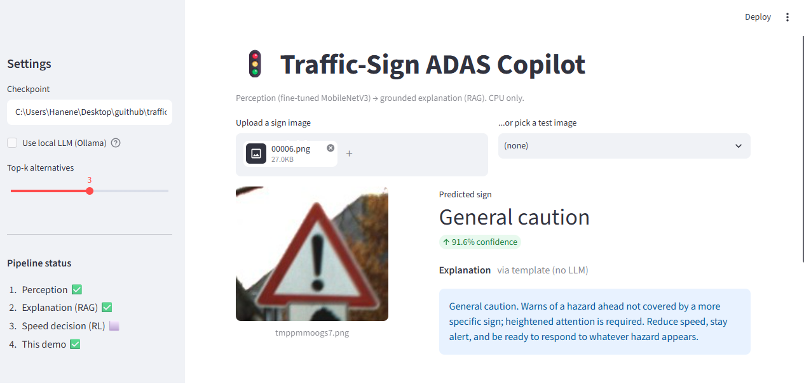
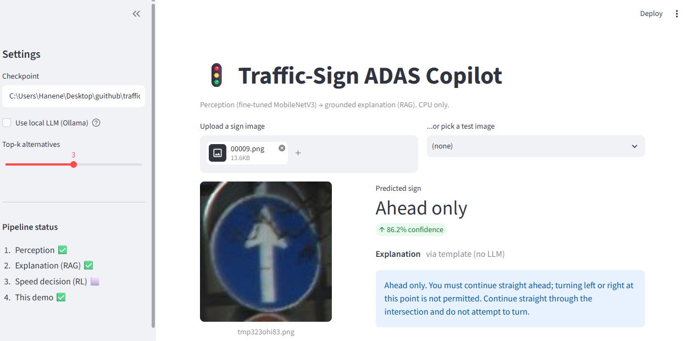

# Traffic-Sign ADAS Copilot

<p align="center">
  
</p>
<p align="center">
  
</p>
<p align="center"><em>Streamlit demo (CPU only): the fine-tuned MobileNetV3-Small predicts the sign, then the explanation is built from the matching rule card of the knowledge base (template mode, no LLM).</em></p>

An end-to-end driver-assistance pipeline built around the GTSRB traffic-sign
dataset, where four ML techniques each own a distinct stage of the system
instead of being bolted onto one classification task:

```
   image ──▶ [ Perception ]──▶ sign label ──▶ [ RAG ]──▶ grounded explanation
              fine-tuning                       traffic-rule retrieval + LLM
                                │
                                ▼
                          [ RL policy ]──▶ target speed ──▶ [ Deployment ]
                          speed control                      Streamlit demo + ONNX
```

- **Fine-tuning** builds the perception model (MobileNetV3-Small, transfer learning).
- **RAG** turns a predicted label into an explanation *grounded* in a small
  traffic-rule knowledge base (no hallucinated rules).
- **Reinforcement learning** will learn a target-speed policy from the detected
  limit (kinematic simulation, not a real vehicle).
- **Deployment** wraps it in a Streamlit demo and exports a portable, quantized
  perception model (ONNX / INT8).

Everything is designed to run on **CPU only** (no GPU required).

A recurring design choice across the project is **graceful degradation**: every
optional dependency has a fallback, so the pipeline runs end-to-end even on a
minimal install (semantic search falls back from sentence-transformers to
TF-IDF, from FAISS to NumPy; the explanation falls back from a local LLM to a
deterministic template).

---

## Status

| Phase | Component        | Technique                    | Status           |
|:-----:|------------------|------------------------------|------------------|
| **1** | Perception       | Fine-tuning (transfer)       | ✅ Done          |
| **2** | Explanation      | RAG (retrieval + local LLM)  | ✅ Done          |
| **3** | Speed decision   | Reinforcement learning (DQN) | 🚧 In progress   |
| **4** | Serving          | Streamlit + ONNX / INT8      | ✅ Demo working  |

---

## Quickstart

```bash
pip install -r requirements.txt
```

Download the Kaggle **GTSRB — German Traffic Sign Recognition Benchmark** dataset
into `data/` so that it contains `Train.csv`, `Test.csv`, `Train/`, `Test/`.

```bash
# Perception → explanation, end to end (no extra services needed)
python src/pipeline/predict_and_explain.py --image data/Test/00001.png --no-llm

# The interactive demo
streamlit run app.py
```

> **Windows / Anaconda note:** keep `numpy < 2`. Anaconda's `pandas`, `pyarrow`
> and `numexpr` are compiled against NumPy 1.x, so NumPy 2.x breaks them. The
> pinned `requirements.txt` reflects this.

---

## Phase 1 — Perception (fine-tuning)

Fine-tunes an ImageNet-pretrained **MobileNetV3-Small** on GTSRB (43 classes).
MobileNetV3-Small is compact and quantization-friendly, which keeps the
perception stage fast on CPU.

### Train

```bash
python src/perception/finetune.py \
    --data-root data \
    --img-size 96 --epochs 20 --batch-size 64 \
    --freeze last_block \
    --out checkpoints/perception_mobilenetv3_v2.pt
```

Freeze strategies: `all` (head only, fastest), `last_block` (default, good
CPU/accuracy trade-off), `none` (full fine-tune, slowest).

### Evaluate (accuracy, size, latency, INT8, ONNX)

```bash
python src/perception/evaluate.py \
    --data-root data \
    --ckpt checkpoints/perception_mobilenetv3_v2.pt \
    --quantize --onnx checkpoints/perception_mobilenetv3_v2.onnx
```

### Results

Measured on CPU, GTSRB test set. Latency is per image and hardware-dependent.

| Model                              | Input | Params | Test acc   | CPU latency | Size (state) |
|------------------------------------|:-----:|:------:|:----------:|:-----------:|:------------:|
| MobileNetV3-S · v1 (fine-tuned)    | 64    | 1.56 M | 83.6 %     | —           | 6.1 MB       |
| MobileNetV3-S · v2 (fine-tuned)    | 96    | 1.56 M | **93.4 %** | ~5 ms/img   | 6.1 MB       |
| MobileNetV3-S · v2 · INT8 dynamic  | 96    | 1.56 M | 93.4 %     | ~5 ms/img   | **4.3 MB**   |

- v2 reaches **99.0 % validation** / **93.4 % test** (img 96, 20 epochs).
- INT8 dynamic quantization shrinks the stored model by **~30 %** (6.1 → 4.3 MB)
  with **no accuracy loss** (+0.02 pt). It does **not** speed up inference here:
  MobileNet is convolution-heavy and dynamic INT8 only quantizes Linear layers,
  so the reliable, honest win is size, not latency.
- ONNX export: `perception_mobilenetv3_v2.onnx` (~6.0 MB), for framework-free
  serving via `onnxruntime`.

---

## Phase 2 — Explanation (RAG)

Turns a predicted class into a natural-language explanation that is *grounded* in
a small traffic-rule knowledge base — the model is never allowed to invent a rule.

- **Knowledge base** — `data/knowledge_base/gtsrb_rules.json`: one entry per GTSRB
  class (43/43), each with `rule`, `context`, `typical_danger`, `driver_action`,
  and a `category` (speed_limit / prohibition / mandatory / warning / priority /
  other). Rules are generic, inspired by Vienna-Convention conventions.
- **Validator** — `src/rag/kb.py`: strict schema + 43/43 coverage + name
  consistency against the canonical class list.
- **Index** — `src/rag/embed_index.py`: embeds the rule cards. Backend is chosen
  automatically: `sentence-transformers` if available, else an offline `TF-IDF`
  fallback (scikit-learn, no download).
- **Retriever** — `src/rag/retriever.py`: exact `by_class_id()` for a detected
  sign, plus semantic `retrieve()` for free-text questions (FAISS or NumPy).
- **Explanation** — `src/rag/explain.py`: builds one rule card and asks a local
  LLM (Ollama) to explain it, forbidding anything not in the card. If no LLM is
  reachable, it falls back to a deterministic template that cannot hallucinate.

```bash
python src/rag/kb.py --path data/knowledge_base/gtsrb_rules.json --validate
python src/rag/embed_index.py
python src/rag/explain.py --class-id 28 --no-llm
python src/rag/explain.py --ask "what do I do near a school?"
```

The retrieval index is rebuilt locally by `embed_index.py` and is git-ignored;
only the authored `gtsrb_rules.json` is versioned.

---

## Bridge — perception → RAG

`src/pipeline/predict_and_explain.py` ties Phase 1 and Phase 2 together: an image
goes in, the fine-tuned model predicts a class (with confidence), and the RAG
layer returns a grounded explanation. For speed-limit signs it also surfaces the
numeric km/h value — the input the Phase 3 RL policy will consume.

```bash
python src/pipeline/predict_and_explain.py --image data/Test/00001.png --no-llm
```

---

## Phase 3 — Speed decision (RL) — in progress

A DQN agent will map `(detected limit, current speed)` to a target-speed action
(brake / hold / accelerate), rewarding compliance with the limit and smooth,
comfortable speed changes. Trained on CPU in a small Gymnasium environment.

---

## Phase 4 — Deployment

- **Streamlit demo** (`app.py`): drop in or pick a sign image and see the
  predicted class, confidence, top-k alternatives, the grounded explanation, and
  the detected speed limit. Model and knowledge base are cached; no index or LLM
  is required (the explanation falls back to the template).

  ```bash
  streamlit run app.py
  ```

- **Portable model**: INT8 + ONNX export produced by `evaluate.py` for
  framework-free CPU serving.

---

## Repository layout

```
app.py                       # Phase 4 — Streamlit demo (image → class → explanation)
src/perception/
    dataset.py               # GTSRB Kaggle-CSV loader (optional ROI crop, ImageNet norm)
    model.py                 # MobileNetV3-Small builder + freeze strategies + size helpers
    finetune.py              # Phase-1 training loop (CPU, AdamW + cosine, best-ckpt saving)
    evaluate.py              # accuracy / size / latency / INT8 dynamic quant / ONNX export
    class_names.py           # 43 GTSRB class names + speed-limit km/h map (bridge to RAG/RL)
src/rag/
    kb.py                    # knowledge-base loader + strict validator
    embed_index.py           # build the semantic index (sentence-transformers or TF-IDF)
    retriever.py             # exact + semantic retrieval (FAISS or NumPy)
    explain.py               # grounded explanation (Ollama, with template fallback)
src/pipeline/
    predict_and_explain.py   # perception → RAG bridge
data/knowledge_base/
    gtsrb_rules.json         # 43 grounded traffic-rule entries (versioned)
checkpoints/                 # trained weights + metrics (git-ignored)
figures/                     # README screenshots of the Streamlit demo
```

---

## Notes on reproducibility (Windows / Spyder)

- Everything targets **CPU**; `DataLoader` uses `num_workers=0` by default and
  scripts run under an `if __name__ == "__main__":` guard.
- Keep **`numpy < 2`** (see the Quickstart note).
- INT8 dynamic quantization reliably reduces model size; the latency change is
  hardware/backend dependent and is reported honestly rather than assumed.
- Reported numbers come from real runs on this machine — the tables never ship
  invented figures.

## License

MIT — see [LICENSE](LICENSE).
